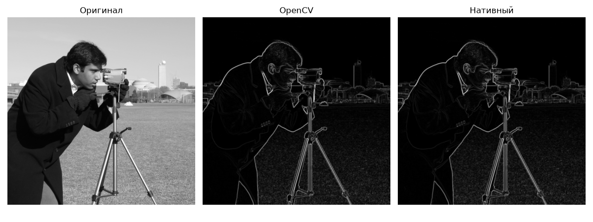
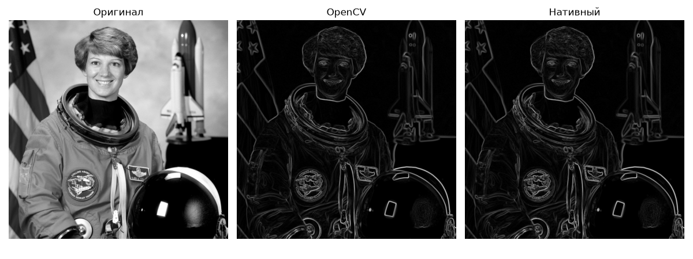
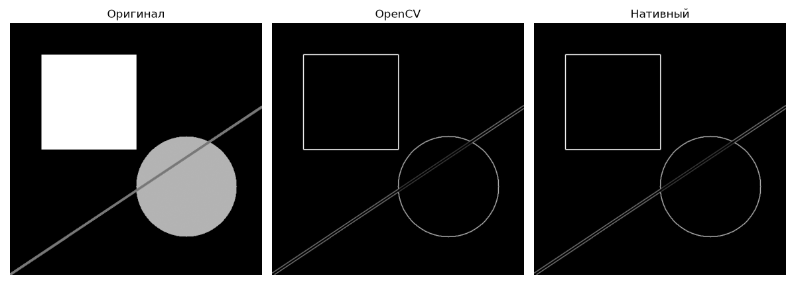
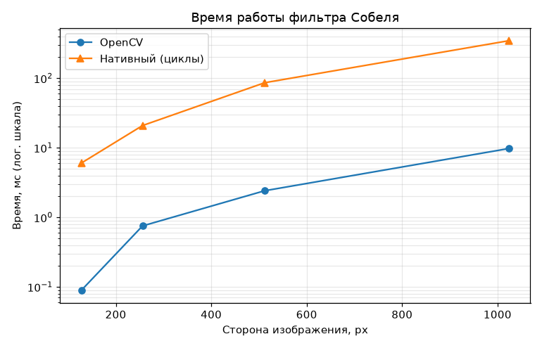

# ЛР1. Фильтр Собеля (вариант 1)

## 1. Теоретическая база

Оператор Собеля приближённо вычисляет градиент яркости изображения и выделяет границы. Для изображения `I` (градации серого) считаются две свёртки с ядрами 3×3:

```
      | -1  0  1 |              | -1 -2 -1 |
Gx =  | -2  0  2 | * I,    Gy = |  0  0  0 | * I
      | -1  0  1 |              |  1  2  1 |
```

`Gx` реагирует на вертикальные границы, `Gy` на горизонтальные. Модуль градиента:

```
G = sqrt(Gx² + Gy²)
```

Ядро раскладывается в произведение сглаживания `[1 2 1]` и разности `[-1 0 1]`, поэтому оператор одновременно подавляет шум и находит перепад яркости. Для вывода `G` нормируется в диапазон 0..255. Границы изображения обрабатываются отражением (`BORDER_REFLECT_101`).

## 2. Описание системы

Всё в одном файле [`sobel.py`](sobel.py). Реализовано две версии:

| Функция | Описание |
|---|---|
| `sobel_opencv` | `cv2.Sobel` по x и y (ядро 3×3), `cv2.magnitude` |
| `sobel_native` | нативные вложенные циклы по пикселям на чистом Python, свёртка раскрыта вручную |

Порядок работы: загрузка изображения в градациях серого, две реализации, сравнение результатов (максимальная разность), замер времени на размерах 128, 256, 512 и 1024 px, сохранение картинок и графика в `results/`.

Тестовые изображения: `camera` и `astronaut` (стандартные, из `skimage.data`) и синтетическое (прямоугольник, круг, линия). Лежат в `images/`.


## 3. Результаты и тестирование

**Корректность.** Максимальная разность между результатами OpenCV и нативной версий равна 0 на всех трёх изображениях.





**Быстродействие**:

| Размер | OpenCV, мс | Нативный, мс | Нативный / OpenCV |
|---|---|---|---|
| 128×128 | 0.090 | 6.0 | 67× |
| 256×256 | 0.753 | 20.9 | 28× |
| 512×512 | 2.413 | 86.2 | 36× |
| 1024×1024 | 9.769 | 346.6 | 35× |




## 4. Выводы

- Фильтр Собеля реализован двумя способами (OpenCV и нативно).
- Нативная версия на циклах медленнее OpenCV примерно в 30–40 раз.
- OpenCV быстрее за счёт оптимизированного кода на C++ и SIMD, а в нативной версии затраты на интерпретатор Python на каждом пикселе.
- Время растёт примерно пропорционально числу пикселей у обеих версий.

## 5. Использованные источники

1. OpenCV documentation: Sobel Derivatives. https://docs.opencv.org/4.x/d2/d2c/tutorial_sobel_derivatives.html
2. scikit-image, `skimage.data` (тестовые изображения). https://scikit-image.org/docs/stable/api/skimage.data.html
