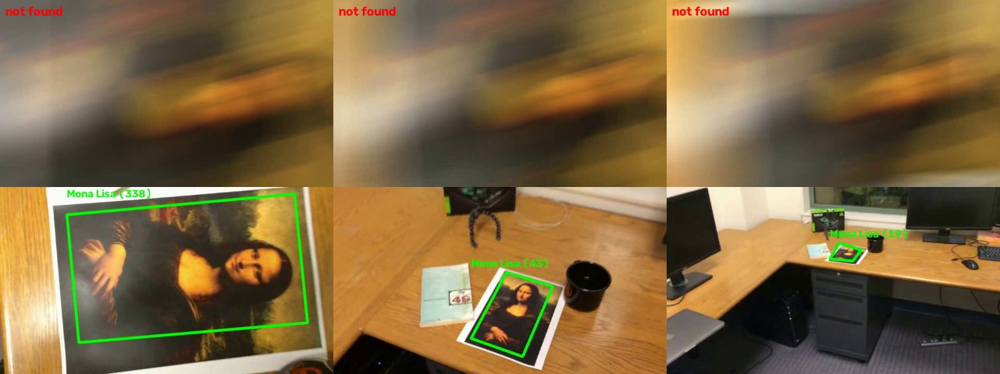
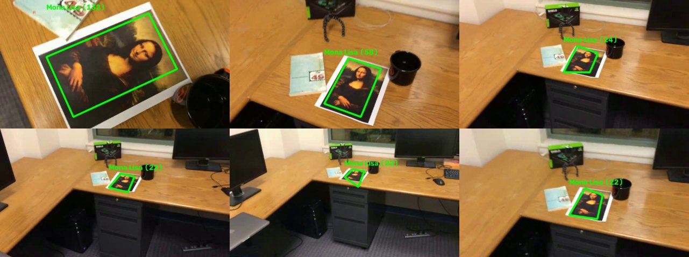
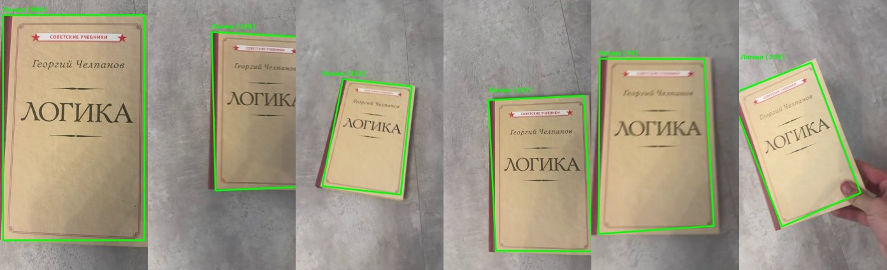

# ЛР2. Трекинг плоского объекта на видео по ключевым точкам

## 1. Теоретическая база

**Ключевые точки и дескрипторы.** Ключевая точка - место изображения, которое можно надёжно найти на другом кадре (углы, пятна). Дескриптор - вектор, описывающий окрестность точки; по расстоянию между дескрипторами точки сопоставляются.

- **SIFT** (Lowe, 2004) ищет экстремумы разности гауссианов в пространстве масштабов, инвариантен к масштабу и повороту, частично к смене освещения и ракурса. Дескриптор - вектор из 128 чисел (гистограммы градиентов), сравнивается по L2.
- **ORB** (Rublee et al., 2011) - быстрый FAST-детектор с ориентацией и бинарный дескриптор BRIEF (256 бит), сравнивается по расстоянию Хэмминга. Быстрее SIFT, но менее устойчив к масштабу и размытию.

**Сопоставление и тест Лоу.** Для каждой точки эталона берутся два ближайших дескриптора на кадре; совпадение принимается, если расстояние до первого меньше `0.8` от расстояния до второго. Так отбрасываются неоднозначные совпадения.

**Гомография и RANSAC.** Плоский объект при любом ракурсе камеры отображается в кадр проективным преобразованием, задаваемым матрицей `H` 3×3 (8 степеней свободы): `p' ~ H·p`. Среди совпадений много ошибочных, поэтому `H` оценивается алгоритмом RANSAC (Fischler, Bolles, 1981): по случайным четвёркам пар строится `H`, выбирается та, с которой согласуется больше всего пар (инлаеров, порог 4 px). Умножением углов эталона на `H` получаем рамку объекта на кадре.

**Оптический поток (Лукас-Канаде).** Из постоянства яркости `I(x+u, y+v, t+1) = I(x, y, t)` и разложения Тейлора получаем уравнение `Ix·u + Iy·v + It = 0` - одно уравнение с двумя неизвестными. Метод Лукаса-Канаде считает, что все пиксели окна движутся одинаково, и решает полученную СЛАУ методом наименьших квадратов. Метод хорошо работает на малых смещениях в текстурированных областях; на больших смещениях применяется пирамида изображений (грубо-к-точному). Источник: лекция «Оптический поток и оценка стерео диспаритета» (Яковенко А.), `Оптический поток.pdf`.

## 2. Описание системы

Всё в одном файле [`track.py`](track.py).

**Эталон.** Первый кадр видео (вырезанный по рамке `--box`, по умолчанию весь кадр) - эталон объекта. Ключевые точки ищутся на нём в трёх масштабах (1, 1/2, 1/4), потому что на видео объект чаще мельче эталона; координаты точек пересчитываются к исходному масштабу. Перед детекцией кадр переводится в серый и обрабатывается CLAHE (выравнивание локального контраста).

**Основной цикл.** Для каждого кадра:

1. **Поток.** Если на прошлом кадре объект найден, его инлаер-точки (пары «точка эталона - положение на кадре») отслеживаются пирамидальным Лукасом-Канаде (`cv2.calcOpticalFlowPyrLK`, окно 21×21, 3 уровня пирамиды). Точки проверяются обратным потоком (ошибка «вперёд-назад» < 1.5 px). По уцелевшим точкам RANSAC строит новую гомографию.
2. **Детектор.** Если поток объект потерял, а также каждые 15 кадров для исправления накопленного дрейфа, выполняется поиск по дескрипторам (SIFT или ORB, `BFMatcher` + тест Лоу + RANSAC). Результат детектора не зависит от предыдущих кадров, поэтому «обнуляет» дрейф и возвращает объект после потери.
3. **Проверка рамки.** Четырёхугольник должен быть выпуклым, иметь разумную площадь; а если объект был найден не более 5 кадров назад, его площадь и положение не могут измениться скачком. Это отсекает вырожденные гомографии и ложные срабатывания.
4. **Вывод.** Углы рамки слегка сглаживаются (`0.7·новый + 0.3·прошлый`), рисуется зелёная рамка с подписью и числом инлаеров. Если объект не найден - надпись `not found`.

**Запуск.**
```
python track.py videos/mona-lisa.avi --label "Mona Lisa"
python track.py videos/video_lab.MOV --label "Логика" --box 9,47,453,754
python track.py videos/mona-lisa.avi --detector orb      # ORB вместо SIFT
python track.py videos/mona-lisa.avi --no-flow           # только детектор, без потока
```
Параметры: `--detector {sift,orb}`, `--flow/--no-flow`, `--box x0,y0,x1,y1`, `--label`, `--out`. Нужны `opencv-python` и `numpy`. Результаты (размеченное видео и кадры) пишутся в `results/`.

## 3. Результаты и тестирование

Тестовые видео: `mona-lisa`, `mona-lisa-blur`, `mona-lisa-blur-extra-credit` (640×360, 558 кадра) и собственное `video_lab` (книга «Логика» Г. Челпанова, 464×848, 753 кадра: сдвиги, повороты, наклоны, перекрытие рукой, быстрое движение). Видео `simple_track.avi` из архива - образец с готовой разметкой (подпись и точки нарисованы в самом видео), в метриках не учитывается.

Метрика - доля кадров, где объект найден (рамка нарисована) и средний размер инлаер-набора. Эталонной разметки нет, поэтому корректность рамок проверена визуально по кадрам из видео.

| Видео | SIFT, только детектор | **SIFT + поток** | ORB + поток |
|---|---|---|---|
| mona-lisa | 59.1 % | **100 %** | 99.6 % |
| mona-lisa-blur | 55.7 % | **96.8 %** | 96.2 % |
| mona-lisa-blur-extra-credit | 55.9 % | **95.0 %** | 82.6 % |
| video_lab (своё) | 86.7 % | **89.2 %** | 88.7 % |

Скорость обработки (кадров/с, CPU, Windows): SIFT только детектор - 13-17; SIFT + поток - 53-134; ORB + поток - 44-127 (быстрее на видео 640×360, где детектор вызывается редко; разброс между прогонами заметный).

**mona-lisa-blur** - кадры 11-36 полностью смазаны движением (объекта в них не видно), `not found` на них корректен. Остальные кадры рамка держит.



**mona-lisa-blur-extra-credit** - объект то крупный, то совсем мелкий (~50 px), размытие по всему видео.



**Собственное видео.**



Пропуски на собственном видео - кадры с сильной смазанностью (быстрый поворот книги) и крутым ракурсом.

## 4. Выводы

- Реализован трекинг плоского объекта: ключевые точки (SIFT/ORB) → сопоставление с тестом Лоу → гомография через RANSAC → рамка с подписью на каждом кадре.
- Один детектор на каждом кадре даёт 56-59 % найденных кадров на тестовых видео: на мелком и размытом объекте точек не хватает.
- Добавление оптического потока Лукаса-Канаде между кадрами подняло долю до 95-100 %. Поток работает там, где дескрипторы уже не сопоставляются, а детектор раз в 15 кадров исправляет дрейф и возвращает объект после потери. Побочный эффект - ускорение в 4-7 раз, так как дорогой детектор вызывается редко.
- На собственном видео крупный объект детектор находит и сам (86.7 %), выигрыш от потока небольшой (89.2 %), зато скорость выросла с 17 до ~53 кадров/с.
- SIFT надёжнее ORB на мелком и размытом объекте (95.0 % против 82.6 % на `extra-credit`), ORB быстрее при сопоставимом результате на простых видео.
- Ограничения: поток требует малых смещений между кадрами; полностью смазанные кадры и объект, ушедший из кадра, дают `not found`; метод работает только для плоских текстурированных объектов (гомография), качество оценено визуально и долей найденных кадров, без эталонной разметки.

## 5. Использованные источники

1. Документация OpenCV: `cv2.SIFT_create`, `cv2.ORB_create`, `cv2.findHomography`, `cv2.calcOpticalFlowPyrLK`. https://docs.opencv.org
