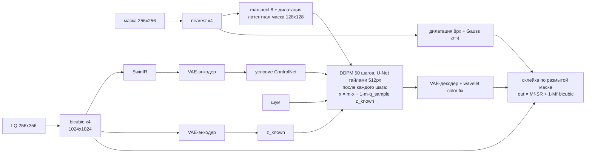

# ЛР3 (усложнённая). SR-inpainting: улучшение фрагмента изображения диффузионной моделью DiffBIR

**Цель:** разобраться в устройстве диффузионных image-to-image моделей и изменить процесс сэмплинга так,
чтобы модель восстанавливала (super-resolution ×4 + удаление деградаций) только область, заданную бинарной маской.

## 1. Теоретическая база

### 1.1 Диффузионные модели (DDPM)
Прямой процесс за T = 1000 шагов постепенно зашумляет изображение; в замкнутой форме

```
q(x_t | x_0) = N( sqrt(ᾱ_t) · x_0 ,  (1 − ᾱ_t) · I ),      ᾱ_t = ∏ (1 − β_s)
```

Нейросеть (U-Net) учится обращать этот процесс. Генерация — цепочка шагов от чистого шума `x_T` к `x_0`:
на шаге t модель предсказывает чистое изображение `x̂_0`, по нему считается среднее апостериорного
распределения `q(x_{t−1} | x_t, x̂_0)` и сэмплируется `x_{t−1}`. Шагов при инференсе меньше, чем при обучении
(respacing, 50 из 1000).

**v-параметризация и zero-SNR** (Lin et al., 2024): сеть предсказывает `v = sqrt(ᾱ_t)·ε − sqrt(1−ᾱ_t)·x_0`,
а расписание шума исправлено так, что на последнем шаге ᾱ_T = 0 — старт из чистого шума, без утечки
низких частот исходника. Так обучена используемая версия Stable Diffusion 2.1.

**Латентная диффузия** (Stable Diffusion): процесс идёт в латентном пространстве VAE —
картинка 512×512×3 ↔ латент 64×64×4 (сжатие в 8 раз по стороне). Условие — текст через CLIP и cross-attention.

**Classifier-free guidance:** `out = out_uncond + s · (out_cond − out_uncond)`; здесь «uncond» —
негативный промпт («размыто, шум, артефакты…»), что тянет результат от низкого качества.

### 1.2 DiffBIR
DiffBIR (Lin et al., ECCV 2024) — двухэтапная модель слепого восстановления изображений:
1. **Restoration module (SwinIR)** — регрессионная сеть убирает деградации (шум, размытие, JPEG). Результат
   чистый, но «замыленный» — PSNR-оптимальный.
2. **Generation module (IRControlNet)** — Stable Diffusion 2.1 с ControlNet, которому на вход подаётся латент
   очищенного изображения. ControlNet — обучаемая копия энкодера U-Net, её признаки через zero-convolution
   добавляются в декодер замороженного U-Net. Диффузия дорисовывает правдоподобные высокочастотные детали.
3. Цветокоррекция wavelet: низкие частоты берутся из выхода SwinIR, высокие — из диффузии.

Используется версия **v2.1** (ControlNet обучен на Unsplash, SD 2.1 zero-SNR) — лучшая по качеству у авторов.
SD 2.1-base обучена на 512×512, поэтому выход 1024×1024 считается тайлами 512 px с перекрытием и гауссовыми
весами (штатный режим DiffBIR, по мотивам Mixture of Diffusers).

### 1.3 Inpainting в диффузионных моделях
Если часть изображения известна, её можно «вшить» в траекторию сэмплинга без дообучения
(RePaint, Lugmayr et al. 2022; Blended Latent Diffusion, Avrahami et al. 2023): после каждого шага известная
область заменяется на известное изображение, зашумлённое до уровня текущего шага через `q(x_t | x_0)`.
Модель на следующем шаге видит согласованный вход и строит неизвестную область с учётом контекста.

В задаче SR-inpainting роли меняются: неизменной остаётся область **вне маски** (там простое bicubic-увеличение
входа), а модель работает **внутри маски**.

## 2. Описание разработанной системы

### 2.1 Алгоритм



1. Вход LQ увеличивается bicubic до выходного размера (×4), маска — nearest-интерполяцией.
2. Маска переводится в латентное разрешение (1/8) через `max_pool` (латентный пиксель в маске, если хоть один из
   его 8×8 пикселей в маске) и расширяется на 1 латентный пиксель — модель генерирует с небольшим перехлёстом.
3. `z_known` — латент bicubic-изображения; условие ControlNet — латент выхода SwinIR (как в DiffBIR).
4. Сэмплинг — штатный `SpacedSampler` DiffBIR, но после каждого шага
   `x_{t−1} ← m·x_{t−1} + (1 − m)·(sqrt(ᾱ_{t−1})·z_known + sqrt(1 − ᾱ_{t−1})·ε)`.
   После последнего шага шум не добавляется — вне маски латент ровно `z_known`.
5. Латент декодируется, применяется штатная wavelet-цветокоррекция DiffBIR.
6. Финальная склейка в пикселях с плавной маской (дилатация 8 px + размытие Гаусса σ = 4): дальше ~20 px от маски
   пиксели **в точности** равны bicubic, шов скрыт в зоне перехлёста.

Особые случаи: маска из единиц → сэмплер полностью совпадает с исходным DiffBIR (бит-в-бит при том же seed);
маска из нулей → улучшать нечего, результат = bicubic, диффузия не запускается.

### 2.2 Архитектура кода

| Файл | Назначение |
|---|---|
| [`masked_sampler.py`](masked_sampler.py) | ядро: `MaskedSamplingMixin` переопределяет цикл `SpacedSampler.sample`, `MaskedSpacedSampler`; работа с маской (`mask_to_latent`, `feather_mask`) |
| [`diffbir_inpaint.py`](diffbir_inpaint.py) | загрузка DiffBIR v2.1, `masked_restore()` — восстановление с маской; CLI для одной картинки |
| [`prepare_data.py`](prepare_data.py) | DIV2K valid → 5 HR-кропов 1024², три деградации ×4, три маски 256² |
| [`run_experiments.py`](run_experiments.py) | 5 изображений × 3 деградации × 3 маски = 45 запусков, замер времени и памяти |
| [`evaluate.py`](evaluate.py) | PSNR, LPIPS, CLIP-IQA (по кадру и по областям), таблицы, графики, сетки сравнения |
| [`test_masked_sampler.py`](test_masked_sampler.py) | проверка логики маски на настоящем `SpacedSampler` DiffBIR без весов |

Исходный код DiffBIR не изменяется: используется его модель, а сэмплер подменяется наследником.

### 2.3 Данные и эксперимент
- **Изображения:** DIV2K validation `0801, 0804, 0810, 0829, 0855` (пингвин, люди, белка, бабочка, портрет),
  центральный кроп 1024×1024.
- **Деградации (вход 256×256, ×4):**
  `bicubic` — официальный DIV2K X4 bicubic; `unknown` — официальный DIV2K X4 unknown (неизвестное ядро);
  `realesrgan` — синтетическая деградация второго порядка как в Real-ESRGAN
  (анизотропное размытие → resize → гауссов/пуассоновский шум → JPEG, дважды; фиксированный seed).
- **Маски (256×256, разрешение входа):** `ones` (всё), `zeros` (ничего), `combined` — круг в центре, 50 % площади.
- **DiffBIR v2.1**, DDPM (spaced) 50 шагов, CFG 6.0, стандартные позитивный/негативный промпты DiffBIR,
  без автоматического описания сцены (LLaVA), seed 231.
- **Метрики:** PSNR (RGB) и LPIPS (AlexNet) относительно HR, CLIP-IQA (без эталона). Все метрики считаются также
  отдельно **внутри круга** и **вне круга** (вне — с отступом 24 px от зоны склейки);
  CLIP-IQA по областям — на центральном кропе 512² и на четырёх угловых кропах 192².

### 2.4 Системные требования
- GPU NVIDIA от 8 ГБ (проверено на RTX 3080 Laptop 8 ГБ), RAM 16 ГБ, ~7 ГБ на диске под веса.
- Windows/Linux, Python 3.11, PyTorch 2.6 + CUDA 12.4, зависимости — [`requirements.txt`](requirements.txt).
- Веса DiffBIR ([HuggingFace](https://huggingface.co/lxq007/DiffBIR-v2)) в `lab_3.2/weights/`:
  `sd2.1-base-zsnr-laionaes5.ckpt` (5.2 ГБ), `DiffBIR_v2.1.pt` (1.5 ГБ), `realesrgan_s4_swinir_100k.pth` (90 МБ).
- Экономия памяти: U-Net и ControlNet в fp16, U-Net и VAE работают тайлами 512 px, текстовый энкодер CLIP после
  кодирования промптов выгружается на CPU. Пик видеопамяти ~6.3 ГБ.
  На Windows процессу задан лимит 92 % видеопамяти: иначе при нехватке драйвер молча выносит память в RAM
  и сэмплинг замедляется в ~7 раз.

### 2.5 Запуск
```bash
cd lab_3.2
python -m venv .venv && .venv/Scripts/activate
pip install torch torchvision --index-url https://download.pytorch.org/whl/cu124
pip install -r requirements.txt
git clone https://github.com/XPixelGroup/DiffBIR
# веса -> weights/ (ссылки выше)
python prepare_data.py            # данные (скачает ~500 МБ DIV2K)
python test_masked_sampler.py     # проверка логики маски
python run_experiments.py         # 45 запусков -> results/sr/
python evaluate.py                # метрики, таблицы, графики -> results/
# одна картинка с произвольной маской:
python diffbir_inpaint.py --lq data/lq/realesrgan/0801.png --mask data/masks/combined.png --out out.png
```

## 3. Результаты и тестирование

### 3.1 Корректность алгоритма
`test_masked_sampler.py` — настоящий `SpacedSampler` DiffBIR с расписанием v2.1, U-Net заменён «моделью»,
всегда предсказывающей фиксированный латент:

| Проверка | Результат |
|---|---|
| маска = 1 совпадает с исходным сэмплером DiffBIR (тот же seed) | бит-в-бит |
| маска = 0 → латент на выходе = `z_known` | да |
| комбинированная: вне маски = `z_known`, внутри = результат диффузии | да |
| плавная маска: центр = 1, дальше 20 px от границы = 0 | да |

### 3.2 Метрики на тестовых изображениях

По каждой паре «деградация × маска» усреднены результаты пяти изображений. Стрелки показывают, в какую сторону улучшается метрика.

| Деградация | Маска | PSNR, дБ ↑ | LPIPS ↓ | CLIP-IQA ↑ |
|---|---|---:|---:|---:|
| bicubic | ones | 20.240 | 0.355 | 0.819 |
| bicubic | combined | 23.376 | 0.442 | 0.691 |
| bicubic | zeros | 25.522 | 0.500 | 0.538 |
| unknown | ones | 18.887 | 0.466 | 0.789 |
| unknown | combined | 20.662 | 0.556 | 0.537 |
| unknown | zeros | 21.280 | 0.626 | 0.390 |
| realesrgan | ones | 20.009 | 0.470 | 0.726 |
| realesrgan | combined | 21.533 | 0.663 | 0.482 |
| realesrgan | zeros | 21.776 | 0.836 | 0.281 |


Во всех трёх группах полное восстановление улучшило средние LPIPS и CLIP-IQA относительно bicubic. У bicubic выше средний PSNR: сгенерированные детали визуально правдоподобны и могут отличаться от пикселей эталона. При комбинированной маске все три средние метрики по кадру оказались между результатами двух крайних режимов.


На деградации Real-ESRGAN внутри маски LPIPS снизился с 0.860 до 0.533, а CLIP-IQA вырос с 0.291 до 0.660 относительно bicubic. За пределами маски с отступом 24 px все 15 комбинированных результатов пиксельно совпали с bicubic (PSNR между ними равен ∞). Пространственная карта LPIPS вычисляется по целому кадру, поэтому её значения вне маски могут зависеть от изменений внутри неё через рецептивное поле сети.

[Метрики по каждому запуску](results/metrics.csv) · [Сводная таблица с метриками по областям](results/summary.md)

### 3.3 Визуальное сравнение

Жёлтая линия показывает границу исходной маски в сетке сравнения. Под ней приведён крупный план перехода без разметки.


[Сетка bicubic](results/figures/grid_bicubic.jpg) · [Сетка unknown](results/figures/grid_unknown.jpg) · [Крупный план 0804](results/figures/zoom_realesrgan_0804.jpg)

### 3.4 Время и видеопамять

| Маска | Среднее время, с | Максимум выделенной памяти PyTorch, ГиБ |
|---|---:|---:|
| ones | 147.86 | 4.23 |
| combined | 149.07 | 4.21 |
| zeros | < 0.01 | 2.77 |

Замер начинается после загрузки модели и входа. Пик для нулевой маски включает уже размещённые в памяти тензоры. Комбинированная маска ограничивает область восстановления, а U-Net по-прежнему вычисляется по всему кадру тайлами. [Замеры по запускам](results/timing.csv)

## 4. Выводы

Модифицированный сэмплер DiffBIR v2.1 восстанавливает заданный фрагмент при увеличении ×4. Подстановка известного латента на каждом шаге удерживает контекст вне маски, а финальная склейка даёт точное совпадение с bicubic за пределами переходной зоны. Это подтверждено тестами сэмплера и сравнением всех 15 результатов с комбинированной маской.

На пяти изображениях DIV2K локальное восстановление в среднем улучшило LPIPS и CLIP-IQA при каждой из трёх деградаций. Снижение среднего PSNR показывает, что улучшение воспринимаемого качества сопровождается отклонениями от эталона. Применение маски в этой реализации почти не меняет время одного прогона.

## 5. Использованные источники

1. Lin X. et al. *DiffBIR: Towards Blind Image Restoration with Generative Diffusion Prior*, ECCV 2024. https://arxiv.org/abs/2308.15070, код: https://github.com/XPixelGroup/DiffBIR
2. Ho J., Jain A., Abbeel P. *Denoising Diffusion Probabilistic Models*, NeurIPS 2020. https://arxiv.org/abs/2006.11239
3. Rombach R. et al. *High-Resolution Image Synthesis with Latent Diffusion Models*, CVPR 2022. https://arxiv.org/abs/2112.10752
4. Zhang L., Rao A., Agrawala M. *Adding Conditional Control to Text-to-Image Diffusion Models* (ControlNet), ICCV 2023. https://arxiv.org/abs/2302.05543
5. Lin S. et al. *Common Diffusion Noise Schedules and Sample Steps are Flawed* (zero-SNR), WACV 2024. https://arxiv.org/abs/2305.08891
6. Liang J. et al. *SwinIR: Image Restoration Using Swin Transformer*, ICCVW 2021. https://arxiv.org/abs/2108.10257
7. Lugmayr A. et al. *RePaint: Inpainting using Denoising Diffusion Probabilistic Models*, CVPR 2022. https://arxiv.org/abs/2201.09865
8. Avrahami O. et al. *Blended Latent Diffusion*, SIGGRAPH 2023. https://arxiv.org/abs/2206.02779
9. Wang X. et al. *Real-ESRGAN: Training Real-World Blind Super-Resolution with Pure Synthetic Data*, ICCVW 2021. https://arxiv.org/abs/2107.10833
10. Agustsson E., Timofte R. *NTIRE 2017 Challenge on Single Image Super-Resolution: Dataset and Study* (DIV2K). https://data.vision.ee.ethz.ch/cvl/DIV2K/
11. Zhang R. et al. *The Unreasonable Effectiveness of Deep Features as a Perceptual Metric* (LPIPS), CVPR 2018. https://arxiv.org/abs/1801.03924
12. Wang J. et al. *Exploring CLIP for Assessing the Look and Feel of Images* (CLIP-IQA), AAAI 2023. https://arxiv.org/abs/2207.12396
13. Chen C. et al. *pyiqa: Image Quality Assessment Toolbox*. https://github.com/chaofengc/IQA-PyTorch
14. Jiménez Á. B. *Mixture of Diffusers for scene composition and high resolution image generation*, 2023. https://arxiv.org/abs/2302.02412
