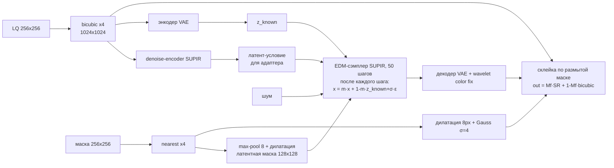
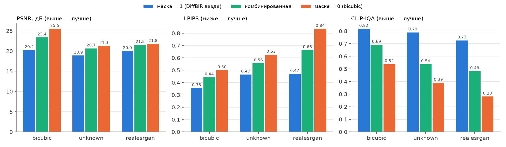
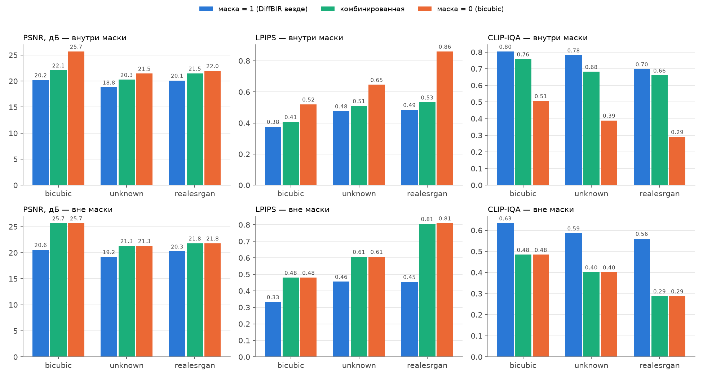
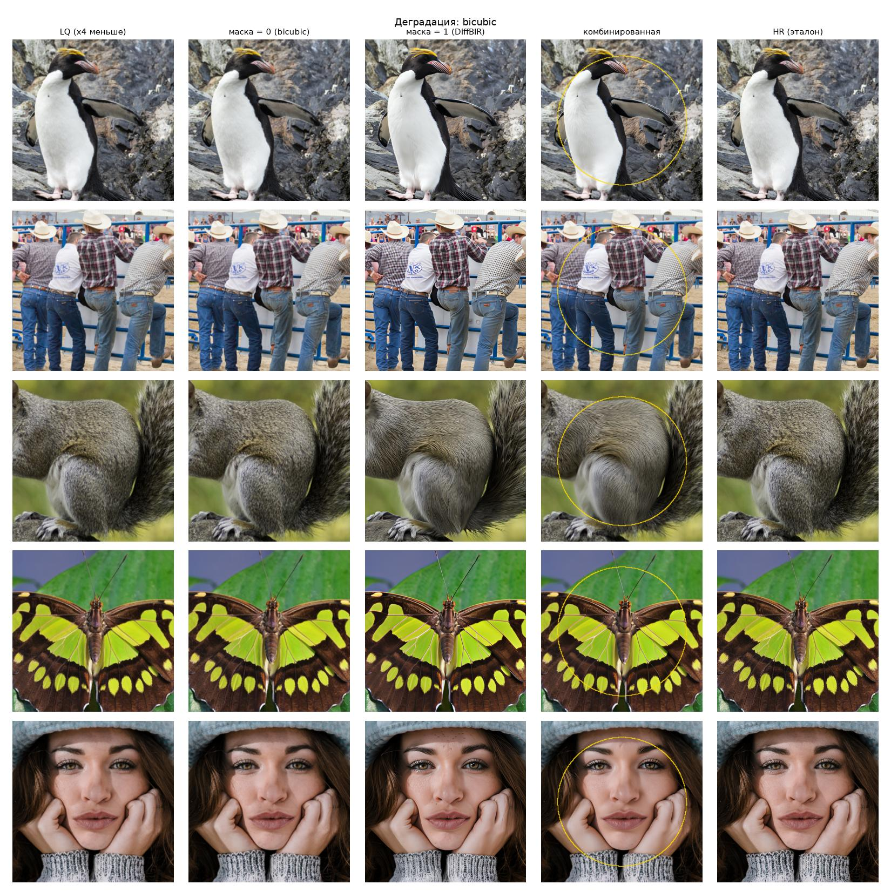
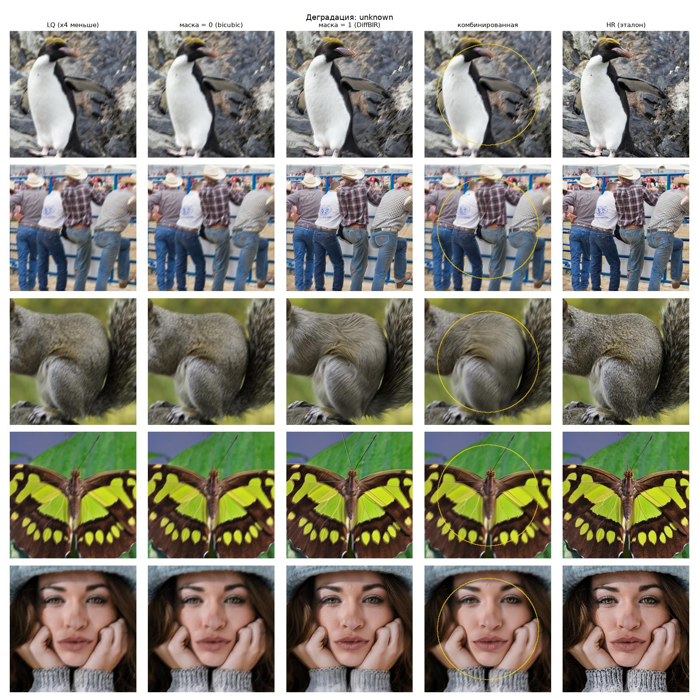
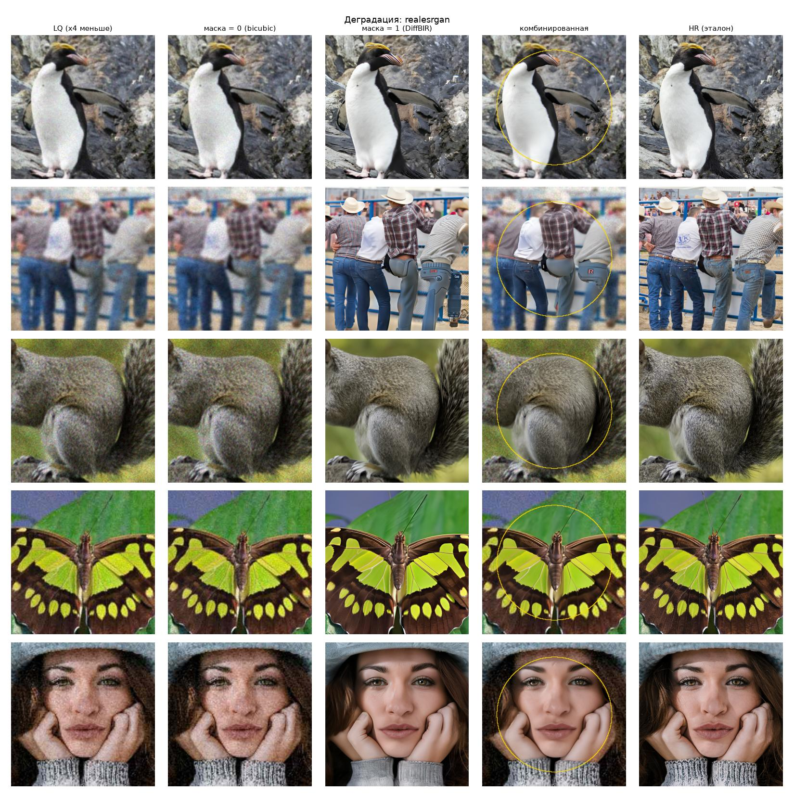
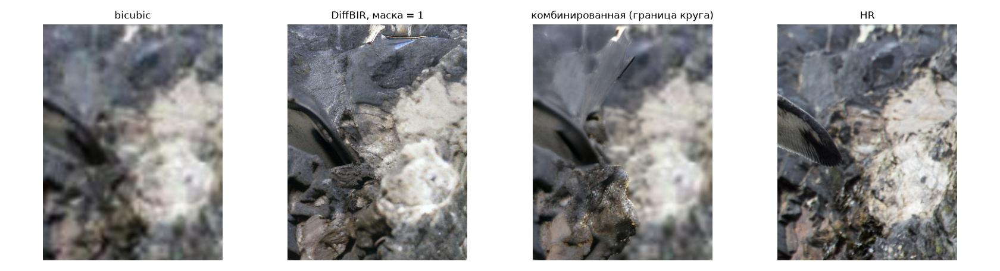

# ЛР3 (усложнённая). SR-inpainting: улучшение фрагмента изображения диффузионной моделью SUPIR

**Цель:** разобраться в устройстве диффузионных image-to-image моделей и изменить процесс сэмплинга так,
чтобы модель восстанавливала (super-resolution + удаление деградаций) только область, заданную бинарной маской.

## 1. Теоретическая база

### 1.1 Диффузионные модели
Прямой процесс постепенно зашумляет изображение: `x_σ = x_0 + σ·ε`, `ε ~ N(0, I)`, σ растёт от 0 до σ_max
(в SDXL/SUPIR σ_max ≈ 14.6). Нейросеть-денойзер `D(x_σ, σ, c)` учится предсказывать чистое `x_0` по
зашумлённому входу и условию `c`. Генерация — обратный процесс: старт с шума `x ~ N(0, σ_max²·I)` и пошаговое
решение ОДУ (формулировка EDM, Karras et al. 2022):

```
dx/dσ = (x − D(x, σ, c)) / σ        шаг Эйлера:  x_{i+1} = x_i + (σ_{i+1} − σ_i) · (x_i − D(x_i, σ_i)) / σ_i
```

**Латентная диффузия** (Stable Diffusion / SDXL) проводит этот процесс не в пикселях, а в латентном
пространстве VAE: картинка 1024×1024×3 ↔ латент 128×128×4 (сжатие в 8 раз по стороне), что делает
сэмплинг большого изображения посильным.

**Classifier-free guidance:** `D = D_uc + s·(D_c − D_uc)` — усиливает влияние текстового промпта.

### 1.2 SUPIR
SUPIR (Yu et al., CVPR 2024) — модель восстановления изображений поверх SDXL (2.6 млрд параметров):
- **degradation-robust encoder** — дообученная копия энкодера VAE, которая отображает деградированный вход
  в латент «как у чистой картинки»;
- **адаптер (ControlNet-подобный, ZeroSFT)** ~ копия энкодера U-Net, по латенту LQ-изображения модулирует
  признаки SDXL на каждом шаге — так модель «знает», что восстанавливать;
- **restoration-guided sampling** — на ранних шагах предсказание подтягивается к латенту LQ (`restore_cfg`),
  чтобы не уйти от содержимого входа;
- текстовые промпты (позитивный «качественное фото…» и негативный «размытие, артефакты…»); в оригинале
  описание сцены генерирует LLaVA-13B, здесь LLaVA не используется (пустое описание + стандартные промпты).

### 1.3 Inpainting в диффузионных моделях
Если часть изображения известна, её можно «вшить» в траекторию сэмплинга без дообучения модели
(RePaint, Lugmayr et al. 2022; Blended Latent Diffusion, Avrahami et al. 2023): на каждом шаге известная
область заменяется на известное изображение, зашумлённое до текущего уровня σ. Модель на следующем шаге
видит согласованный вход и дорисовывает неизвестную область с учётом контекста.

В задаче SR-inpainting роли меняются: «известная» (не меняющаяся) часть — это **вне маски**, там остаётся
простое bicubic-увеличение входа; «генерируемая» — **внутри маски**, там работает SUPIR.

## 2. Описание разработанной системы

### 2.1 Алгоритм



1. Вход LQ увеличивается bicubic до выходного размера (×4), маска — nearest-интерполяцией.
2. Маска переводится в латентное разрешение (1/8) через `max_pool` (латентный пиксель в маске, если хоть один из
   его 8×8 пикселей в маске) и расширяется на 1 латентный пиксель — модель генерирует с небольшим перехлёстом.
3. `z_known` — латент bicubic-изображения (обычный энкодер VAE).
4. Сэмплинг идёт штатным циклом SUPIR (`RestoreEDMSampler`), но после каждого шага Эйлера:
   `x ← m·x + (1 − m)·(z_known + σ_{i+1}·ε)`. На последнем шаге σ = 0, т.е. вне маски латент ровно `z_known`.
5. Латент декодируется, применяется штатная wavelet-цветокоррекция SUPIR.
6. Финальная склейка в пикселях с плавной маской (дилатация 8 px + размытие Гаусса σ = 4): дальше ~20 px от маски
   пиксели **в точности** равны bicubic, а шва на границе нет — переход скрыт в зоне перехлёста.

Особые случаи: маска из единиц → поведение и случайные числа полностью совпадают с исходным SUPIR
(результат бит-в-бит тот же при том же seed); маска из нулей → улучшать нечего, результат = bicubic,
диффузия не запускается.

### 2.2 Архитектура кода

| Файл | Назначение |
|---|---|
| [`masked_sampler.py`](masked_sampler.py) | ядро: `MaskedSamplingMixin` (переопределяет цикл сэмплера), `MaskedRestoreEDMSampler`, работа с маской (`mask_to_latent`, `feather_mask`) |
| [`supir_inpaint.py`](supir_inpaint.py) | загрузка SUPIR с экономией памяти, `masked_sample()` — аналог `SUPIRModel.batchify_sample` с маской; CLI для одной картинки |
| [`prepare_data.py`](prepare_data.py) | DIV2K valid → 5 HR-кропов 1024², три деградации ×4, три маски 256² |
| [`run_experiments.py`](run_experiments.py) | 5 изображений × 3 деградации × 3 маски = 45 запусков, замер времени и памяти |
| [`evaluate.py`](evaluate.py) | PSNR, LPIPS, CLIP-IQA (по кадру и по областям), таблицы, графики, сетки сравнения |
| [`test_masked_sampler.py`](test_masked_sampler.py) | проверка логики маски без GPU и весов |
| [`supir_kaggle.ipynb`](supir_kaggle.ipynb) | полный запуск на Kaggle |

Исходный код SUPIR не модифицируется: новый сэмплер подставляется через `sampler_config.target`
(`instantiate_from_config`), а модуль `CKPT_PTH` подменяется в `sys.modules`.

### 2.3 Данные и эксперимент
- **Изображения:** DIV2K validation `0801, 0804, 0810, 0829, 0855` (пингвин, люди, белка, бабочка, портрет),
  центральный кроп 1024×1024.
- **Деградации (вход 256×256, ×4):**
  `bicubic` — официальный DIV2K X4 bicubic; `unknown` — официальный DIV2K X4 unknown (неизвестное ядро);
  `realesrgan` — синтетическая деградация второго порядка как в Real-ESRGAN
  (анизотропное размытие → resize → гауссов/пуассоновский шум → JPEG, дважды; фиксированный seed).
- **Маски (256×256, разрешение входа):** `ones` (всё), `zeros` (ничего), `combined` — круг в центре, 50 % площади.
- **SUPIR-v0Q**, 50 шагов EDM, CFG 4.0 (линейно от 1.0), `s_churn = 5`, `s_noise = 1.01`, seed 1234,
  wavelet color fix — параметры по умолчанию из `SUPIR/test.py`.
- **Метрики:** PSNR (RGB) и LPIPS (AlexNet) относительно HR, CLIP-IQA (без эталона). Для понимания работы
  маски все метрики считаются также отдельно **внутри круга** и **вне круга** (вне — с отступом 24 px от зоны склейки);
  CLIP-IQA по областям — на центральном кропе 512² и на четырёх угловых кропах 192².

### 2.4 Системные требования
- GPU NVIDIA ≥ 16 ГБ (проверялось на Kaggle T4 16 ГБ), RAM ≥ 30 ГБ (загрузка SDXL в CPU-память), ~30 ГБ на диске под веса.
- Python 3.10+, PyTorch ≥ 2.1 с CUDA, зависимости — [`requirements.txt`](requirements.txt).
- Веса: [SDXL base 1.0 (0.9vae)](https://huggingface.co/stabilityai/stable-diffusion-xl-base-1.0),
  [SUPIR-v0Q](https://huggingface.co/camenduru/SUPIR), CLIP ViT-L и OpenCLIP ViT-bigG (скачиваются автоматически).
- Экономия памяти: U-Net и адаптер в fp16, VAE в fp32 (в fp16 SUPIR даёт NaN, а bf16 не поддерживается T4/P100),
  тайловый VAE, текстовые условия считаются один раз, после чего CLIP-энкодеры выгружаются на CPU.
- 8 ГБ VRAM (RTX 3080 Laptop) для SUPIR недостаточно, поэтому модель запускалась на Kaggle.

### 2.5 Запуск
```bash
python prepare_data.py            # данные (скачает ~500 МБ DIV2K)
python test_masked_sampler.py     # проверка логики маски, GPU не нужен
python run_experiments.py --supir_root ../SUPIR --sdxl_ckpt sd_xl_base_1.0_0.9vae.safetensors --supir_ckpt SUPIR-v0Q.ckpt
python evaluate.py                # метрики, таблицы, графики -> results/
# одна картинка с произвольной маской:
python supir_inpaint.py --supir_root ../SUPIR --sdxl_ckpt ... --supir_ckpt ... \
    --lq data/lq/realesrgan/0801.png --mask data/masks/combined.png --out out.png
```
Или целиком: открыть `supir_kaggle.ipynb` на Kaggle (GPU T4, Internet on) и выполнить все ячейки.

## 3. Результаты и тестирование

### 3.1 Корректность алгоритма
`test_masked_sampler.py` и проверка на настоящем `RestoreEDMSampler` из SUPIR (денойзер заменён фиктивным):

| Проверка | Результат |
|---|---|
| маска = 1 совпадает с исходным сэмплером SUPIR (тот же seed) | бит-в-бит |
| маска = 0 → латент на выходе = `z_known` | да |
| комбинированная: вне маски = `z_known`, внутри = результат диффузии | да |
| плавная маска: центр = 1, дальше 20 px от границы = 0 | да |

> **TODO после прогона на Kaggle:** вставить строку из `results/summary.md` —
> PSNR(combined, bicubic) вне маски (ожидается ∞) и PSNR(combined, SUPIR-full) внутри маски.

### 3.2 Метрики

> **TODO:** вставить таблицу из `results/summary.md` после прогона.



Метрики отдельно внутри и вне маски:



### 3.3 Визуальное сравнение





Крупный план границы маски (жёлтая окружность на сетках — граница области восстановления):



### 3.4 Время и память
> **TODO:** вывод `evaluate.py` (среднее время на изображение и пик памяти GPU по маскам).

## 4. Выводы

> **TODO:** дописать по фактическим цифрам. Что проверить в результатах:
> - маска = 1: LPIPS и CLIP-IQA значительно лучше bicubic, PSNR может быть ниже или на уровне bicubic,
>   т.к. генеративная модель дорисовывает правдоподобные, но не совпадающие попиксельно детали;
> - комбинированная маска: внутри круга метрики совпадают с маской = 1, снаружи — с маской = 0,
>   итоговые метрики по кадру лежат между ними примерно пропорционально площади (50 %);
> - разница между деградациями: bicubic восстанавливается проще всего, realesrgan (шум + JPEG) — сложнее,
>   и именно на нём выигрыш SUPIR над bicubic наибольший;
> - отсутствие видимого шва на границе маски.

## 5. Использованные источники

1. Yu F. et al. *Scaling Up to Excellence: Practicing Model Scaling for Photo-Realistic Image Restoration In the Wild* (SUPIR), CVPR 2024. https://arxiv.org/abs/2401.13627, код: https://github.com/Fanghua-Yu/SUPIR
2. Podell D. et al. *SDXL: Improving Latent Diffusion Models for High-Resolution Image Synthesis*, 2023. https://arxiv.org/abs/2307.01952
3. Karras T. et al. *Elucidating the Design Space of Diffusion-Based Generative Models* (EDM), NeurIPS 2022. https://arxiv.org/abs/2206.00364
4. Rombach R. et al. *High-Resolution Image Synthesis with Latent Diffusion Models*, CVPR 2022. https://arxiv.org/abs/2112.10752
5. Lugmayr A. et al. *RePaint: Inpainting using Denoising Diffusion Probabilistic Models*, CVPR 2022. https://arxiv.org/abs/2201.09865
6. Avrahami O. et al. *Blended Latent Diffusion*, SIGGRAPH 2023. https://arxiv.org/abs/2206.02779
7. Wang X. et al. *Real-ESRGAN: Training Real-World Blind Super-Resolution with Pure Synthetic Data*, ICCVW 2021. https://arxiv.org/abs/2107.10833
8. Agustsson E., Timofte R. *NTIRE 2017 Challenge on Single Image Super-Resolution: Dataset and Study* (DIV2K). https://data.vision.ee.ethz.ch/cvl/DIV2K/
9. Zhang R. et al. *The Unreasonable Effectiveness of Deep Features as a Perceptual Metric* (LPIPS), CVPR 2018. https://arxiv.org/abs/1801.03924
10. Wang J. et al. *Exploring CLIP for Assessing the Look and Feel of Images* (CLIP-IQA), AAAI 2023. https://arxiv.org/abs/2207.12396
11. Chen C. et al. *pyiqa: Image Quality Assessment Toolbox*. https://github.com/chaofengc/IQA-PyTorch
